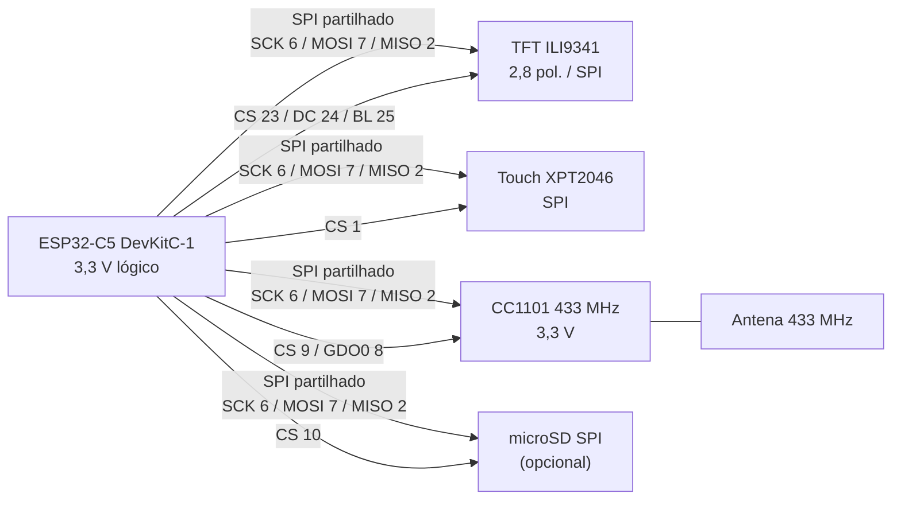

# Esquema de montagem — ESP32-C5 + ILI9341/XPT2046 + CC1101

> Fonte técnica de pinos: [Bruce `boards/ESP32-C5-tft/connections.md`](../boards/ESP32-C5-tft/connections.md), [`ESP32-C5-tft.ini` do upstream](https://github.com/BruceDevices/firmware/blob/1.17/boards/ESP32-C5-tft/ESP32-C5-tft.ini).
> **Esquema lógico, não layout físico de uma placa específica.** Confirmar a serigrafia e pinout da ESP32-C5 DevKitC-1 recebida antes de ligar cabos.

## Diagrama funcional

## Ligações elétricas

| Sinal da placa ESP32-C5 | Ligar a TFT ILI9341 | Ligar a Touch XPT2046 | Ligar a CC1101 | microSD opcional |
| --- | --- | --- | --- | --- |
| **GPIO6 — SPI SCK** | SCK / CLK | T_CLK | SCK / SCLK | SCK |
| **GPIO7 — SPI MOSI** | SDI / MOSI | T_DIN | MOSI / SI | MOSI |
| **GPIO2 — SPI MISO** | SDO / MISO (se exposto) | T_DO | MISO / SO | MISO |
| **GPIO23** | TFT_CS | — | — | — |
| **GPIO24** | TFT_DC / RS | — | — | — |
| **GPIO25** | TFT_BL / LED, confirmar circuito do módulo | — | — | — |
| **GPIO1** | — | T_CS | — | — |
| **GPIO9** | — | — | CS / CSN | — |
| **GPIO8** | — | — | GDO0 | — |
| **GPIO10** | — | — | — | CS |
| **3V3 e GND** | Alimentação compatível e GND | 3,3 V e GND se módulo independente | **3,3 V e GND** | alimentação compatível e GND |

**TFT_RESET:** a documentação Bruce indica `C5 RST` para reset do display; no firmware `TFT_RST=-1`. A ligação física depende do módulo escolhido e da topologia do circuito de reset. Não associar um GPIO arbitrário.

**T_IRQ:** não usado pelo pinout Bruce apresentado (`TOUCH_INT=-1`), deixar desligado nesta montagem. **CC1101 GDO2:** não exigido para este pinout. **GPIO0 e GPIO28:** não ligar botões de 3 vias na configuração tátil, salvo projeto explícito e firmware revisto.

## Onde encontrar os GPIO no DevKitC-1 oficial

Segundo a documentação **Espressif DevKitC-1 v1.2**:

- Conector **J1**: 3V3=pino 1; RST=pino 2; GPIO2=pino 3; GPIO1=pino 6; GPIO6=pino 7; GPIO7=pino 8; GPIO8=pino 9; GPIO9=pino 10; GPIO10=pino 11; GPIO25=pino 13; GND=pino 15.
- Conector **J3**: GND=pino 1; GPIO24=pino 4; GPIO23=pino 5; GPIO28=pino 11.
- Referência do fabricante: https://docs.espressif.com/projects/esp-dev-kits/en/latest/esp32c5/esp32-c5-devkitc-1/user_guide.html

**Importante:** a disposição de GPIO8/9/10 nos headers difere entre revisões v1.1 e v1.2 do DevKitC-1. Identificar a revisão impressa na placa e confirmar a serigrafia antes de usar esta correspondência física. GPIO7 e GPIO25 também têm funções de arranque (*strapping*); evitar cargas que forcem níveis inesperados durante o reset.

## Ordem segura de ligação e teste

1. Desligar USB e qualquer fonte de alimentação.
2. Confirmar **polaridade**, massa comum e compatibilidade dos níveis lógicos. O CC1101 é **3,3 V**, nunca 5 V.
3. Ligar apenas o TFT; testar menus, backlight, toque e orientação.
4. Ligar CC1101 e a **antena da banda correta**; validar deteção/receção sem emitir.
5. Se necessário, acrescentar microSD (CS10) evitando colisões de chip-select.
6. Fixar cabos com isolamento e caixa quando a montagem estiver eletricamente validada.
7. Não fazer transmissões para portões ou outros equipamentos que não sejam próprios ou autorizados.

## Atenções à compra

- Procurar **ILI9341 com XPT2046** efetivo e pinos SPI acessíveis. «2,8 TFT touch» sem referência não basta.
- Procurar CC1101 com módulo de **433 MHz** e antena da mesma banda; verificar a frequência real da central autorizada antes de comprar.
- Evitar comprar o kit **NM-CYD-C5** como substituto direto desta montagem: a placa tem pinout e firmware-alvo diferentes do `esp32-c5-tft` escolhido aqui.
- A montagem em breadboard usa fios curtos e adequados. Não alimentar o rádio pelo pino 5V.

**Estado:** desenho lógico derivado dos pinos oficiais. **Não foi inspecionada nem testada uma montagem física.**
